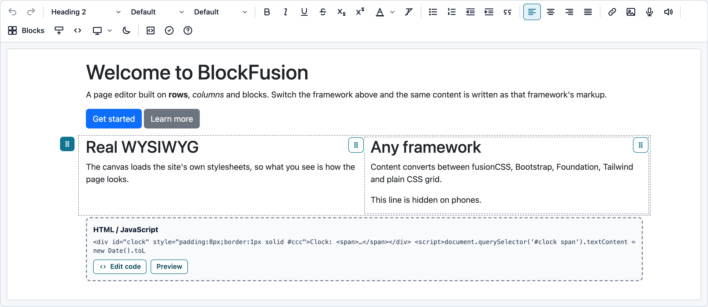

<p align="center">
	<picture>
		<source media="(prefers-color-scheme: dark)" srcset="docs/images/logo-dark.svg">
		
	</picture>
</p>

<p align="center">An accessible WYSIWYG page editor built on rows, columns and blocks, that writes clean markup for your site's own CSS framework.</p>

<p align="center">
	<picture>
		<source media="(prefers-color-scheme: dark)" srcset="docs/images/editor-dark.png">
		
	</picture>
</p>

## Why BlockFusion

- **True WYSIWYG.** The page is edited inside your site's own stylesheets, in an iframe, so what you see is how it looks.
- **Your framework's markup.** Content is written as clean grid markup for fusionCSS, Bootstrap 3, 5 or 6, Foundation 5 or 6, Tailwind CSS or a plain CSS grid, and markup from any of them converts to the others.
- **Rows, columns and blocks.** Lay a page out in rows of columns, move and resize them, and insert ready-made blocks.
- **Accessible.** WCAG 2.2 AA in light and dark, fully usable from the keyboard, with announcements for screen readers and a built-in contrast checker.
- **No dependencies.** One script and one stylesheet, no CDN, MIT licensed.
- **Optional extras.** Dictation and read aloud with the browser's speech APIs, and an AI assistant that rewrites text, describes images and changes the page on request, with models in the browser or on your server.

## Quick start

The built files are in `dist/`, so you don't need Node to use them.

```html
<link rel="stylesheet" href="dist/blockfusion.css">
<script src="dist/blockfusion.js"></script>

<form method="post">
	<textarea name="content"><div class="row"><div class="span-s12"><p>Hello</p></div></div></textarea>
	<button>Save</button>
</form>

<script>
	BlockFusion.create(document.querySelector('textarea[name=content]'), {
		converter: 'fusioncss',
		stylesheets: ['/theme/fusioncss.css', '/theme/site.css'],
	});
</script>
```

On a `<textarea>` the editor keeps the field up to date, so normal form posts just work. It's also an ES module (`dist/blockfusion.mjs`). See [Getting started](docs/getting-started.md).

## What it does

- **Layout:** add rows from a layout picker, then add, move, resize, duplicate and delete rows and columns, with spans per breakpoint and settings for class, id, background and attributes.
- **Rich text:** headings, fonts and sizes, bold, italic and the rest, lists, quotes, alignment, links, images and colour, an HTML source view, and paste cleaning for Word and Google Docs.
- **Blocks:** a searchable block menu; blocks are data, so each one renders for whichever framework is active.
- **Raw HTML and JavaScript** rows and columns, written out as they are and never run in the editor.
- **Undo and redo** for structure and text, as one step per change.
- **Site colour modes:** when the site has a dark mode, the editor previews the page in it.
- **Extensible:** add frameworks, blocks, toolbar items, commands, menu items and a code editor, and connect your own file manager.

## AI assistant

The optional assistant fixes or rewrites the selected text and keeps its formatting, suggests alt text for images, and in its chat changes the page on request ("add a row with 3 columns"). Every change is shown first and can be undone. It can use:

- **models in the browser** (the `blockfusion-ai` extension), so nothing leaves the device; or
- **any OpenAI-compatible model on your server** (`completionsAssistant`), with your backend relaying the requests.

See [AI assistant](docs/ai-assistant.md).

## Documentation

- [Getting started](docs/getting-started.md)
- [Options](docs/options.md) and [API](docs/api.md)
- [Frameworks and converters](docs/frameworks.md)
- [Blocks](docs/blocks.md), [Media provider](docs/media.md) and [Plugins](docs/plugins.md)
- [Dictation and read aloud](docs/speech.md)
- [AI assistant](docs/ai-assistant.md)
- [Accessibility](docs/accessibility.md)
- [Development](docs/development.md), including known limitations
- [Architecture](ARCHITECTURE.md)

## Demos

Serve the repository (`npm run demo`, then open http://localhost:8080/demo/):

- `demo/index.html`: the editor, with a framework switcher, light and dark, and the output;
- `demo/ai.html`: the assistant with models in the browser;
- `demo/ai-server.html`: the assistant with a model on a server (a local Ollama).

## Contributing

Contributions are welcome. See [CONTRIBUTING.md](CONTRIBUTING.md). Pull requests need the shared [Contributor License Agreement](CONTRIBUTOR_LICENSE_AGREEMENT.md), signed once for every project under [github.com/paularlott](https://github.com/paularlott); a GitHub check confirms it on each pull request. Please follow the [Code of Conduct](CODE_OF_CONDUCT.md).

## Licence

BlockFusion is released under the [MIT License](LICENSE.txt). Copyright (c) 2026 Paul Arlott.
