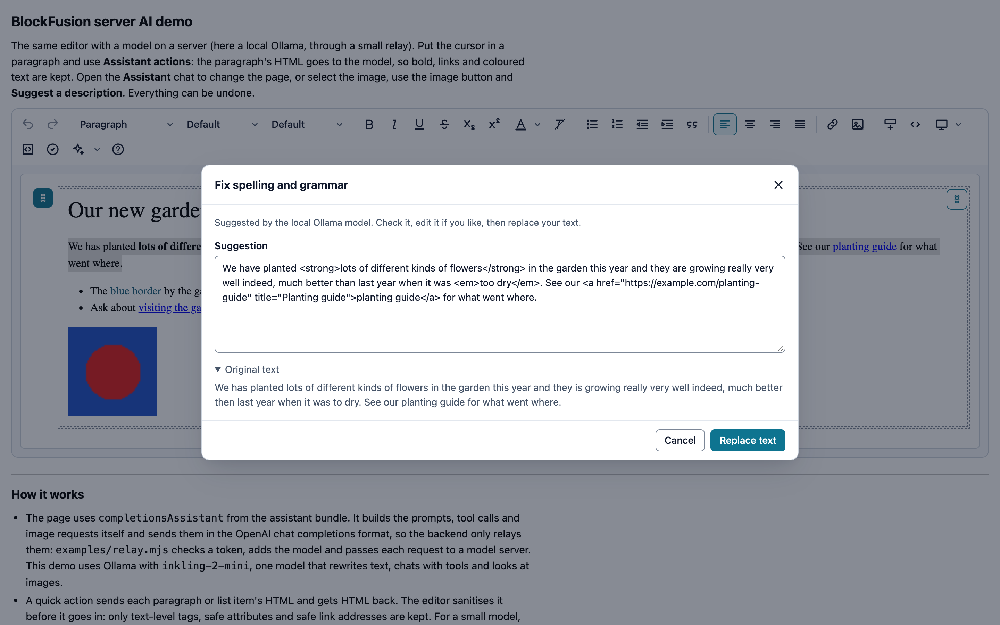

# AI assistant



An optional assistant. The app decides what it offers: which models, which one-shot actions, and whether to chat.

It lives in its own file, so a page that doesn't use AI downloads none of it (no code in `blockfusion.js`, no styles in `blockfusion.css`):

```html
<script src="blockfusion.js"></script>
<script src="blockfusion-assistant.js"></script>  <!-- registers itself; global BlockFusionAssistant -->
```

As modules: `import { assistantPlugin, completionsAssistant } from './blockfusion-assistant.mjs'`, then `BlockFusion.use(assistantPlugin)` or pass it in `plugins`.

The **Assistant** button (sparkle icon) is a split button when chat is on: the button opens the chat, and the arrow beside it the one-shot actions and **Describe the selected image…**. Without chat it is just the menu of actions.

- **Images:** the image dialog gets **Suggest a description**, which fills in the alt text for the author to check and edit; **Describe the selected image…** opens it for the selected image and starts straight away.
- **One-shot actions** on the selection or the paragraph the cursor is in. The suggestion streams into a dialog, where the author can edit it; **Replace text** applies it as one undo step. Each paragraph or list item is rewritten in its own request and keeps its element and attributes, and inline formatting (bold, links, styled text) is kept; see [Formatting](#formatting-in-rewrites).
- **Chat** (`assistantChat: true`): the Assistant button (or Mod+; then A) opens a popover, centred under the toolbar, to talk to the assistant and have it change the page: "add a row with 3 columns", "in row 2 column 1 write a short welcome". The model sees an outline of the page (rows, columns, the start of their text, the cursor) and can add rows, write into columns and type at the cursor; there's no delete. Text it writes can carry `**bold**`, `*italic*` and `` `code` ``, which become formatting. Each change is an undo step, and the latest request's changes have an Undo button in the chat. The conversation, and a request still running, carry on while the chat is closed. A request stops when the model says it's done, repeats itself, or after six rounds.

```js
BlockFusion.create(el, {
	assistant: provider,                  // required; see below
	assistantChat: true,                  // default false
	assistantActions: [                   // default: improve, fix, shorten, simplify; [] for none
		{ id: 'shorten', label: 'Make shorter', prompt: 'Make the text shorter and more direct. Keep the key points, facts and language.' },
		{ id: 'friendly', label: 'Make it friendlier', prompt: 'Rewrite the text in a warm, friendly tone. Keep the facts and language.' },
	],
});
```

The `prompt` is the instruction the provider gets with the text. `BlockFusionAssistant.DEFAULT_ASSISTANT_ACTIONS` has the defaults.

It's off by default. Give an `assistant` provider: models in the browser, or a model on your server.

```js
// In the browser, with small open models (the blockfusion-ai extension, loaded only when used)
import { localAssistant } from './blockfusion-ai/blockfusion-ai.mjs';
BlockFusion.create(el, { assistant: localAssistant({ chatModel: 'onnx-community/Qwen3-0.6B-ONNX' }), assistantChat: true });

// On your server: any OpenAI-compatible model, through your backend
BlockFusion.create(el, {
	assistant: BlockFusionAssistant.completionsAssistant({
		url: '/ai/chat/completions',
		headers: async () => ({ Authorization: `Bearer ${await getToken()}` }),
	}),
	assistantChat: true,
});
```

## A model on your server

`completionsAssistant` builds the prompts, tool calls and image requests in the page and sends them in the OpenAI chat completions format, so your backend only relays them to a model server: it adds the model and API key, and checks the user may use it. It works with anything that serves `/v1/chat/completions`: OpenAI, Ollama, LM Studio, llama.cpp, vLLM, or a gateway in front of other providers. `examples/relay.mjs` is a dependency-free Node relay to start from (it checks a token, sets the model and streams the reply back). Its settings are environment variables: `PORT` (default 8790), `AI_BASE_URL` (default Ollama's `http://localhost:11434/v1`), `AI_MODEL` (set on every request; empty leaves the page's choice), `AI_API_KEY`, `AI_TOKEN` (a bearer token callers must send), `ALLOW_ORIGIN` (CORS, default `*`) and `AI_IMAGE_HOSTS`.

Images go to the model as data when the page can read the file. An image on another site that doesn't allow pages to read it (no CORS) goes as its address, and many model servers (Ollama among them) only take data, so the example relay fetches it: http(s) only, images only, up to 8 MB, and never from private or local addresses unless listed in `AI_IMAGE_HOSTS` (it would otherwise let anyone reach machines inside your network). With in-browser models such an image can't be described at all; the editor says so.

Options:

- **`url`**, **`headers`** and **`credentials`**: where to send requests. `headers` may be a function (sync or async) called before every request, so a fresh token goes with each; `credentials` defaults to `same-origin`, so a session cookie goes too.
- **`send(body, { signal })`**: instead of `url`, send the request yourself (another transport, extra signing …) and return the `Response`.
- **`model`**, **`visionModel`**, **`chatModel`**: model names to put in requests. Leave them out to let the backend choose.
- **`body`**: extra fields for every request, e.g. `{ reasoning_effort: 'none' }` to keep a thinking model quick.
- **`html`** (default true): rewrites send HTML and take HTML back. Set false for a small model.
- **`chat`**, **`images`** (default true): turn off the chat (needs tool calls) or image descriptions (needs a model that takes images).
- **`largeContext`** (default true): the chat sends the whole selection and the whole text of the column the cursor is in (up to 8,000 characters each), so the model can rewrite them. Set false for a small model, which then gets short previews, as the in-browser models do.
- **`name`** (default "the server"): shown with suggestions ("Suggested by …").

Replies may be streamed (`text/event-stream`) or plain JSON. A slow model can outlast the timeout of a proxy in front of your backend (Apache and nginx often wait only 30 to 60 seconds for the first byte). The backend can start its response straight away and send something harmless while it waits: whitespace before a JSON reply, or comment lines (`: waiting`) in an event stream. As the 200 status has then gone, it reports a later failure in the body, as `{"error": {"message": "…"}}` in the JSON or in a `data:` event, and the editor shows that message.

## Formatting in rewrites

- **HTML** (`html` on the provider): each paragraph's HTML goes out and HTML comes back. The editor sanitises the reply before it goes in: text-level tags only, a short list of attributes, and safe link addresses (relative, http(s), mailto, tel, or a CMS tag such as `[[~26]]`). The dialog names any link the reply left out.
- **Marks** (in-browser models): formatting goes out as Markdown-style marks (`**bold**`, `*italic*`, `` `code` ``, `[words](1)` for links and styled text). Links and styled text are rebuilt from the original elements, so an address or style can't be changed, and formatting is put back on the same words when a small model drops the marks. The dialog names any phrase whose formatting couldn't be kept because its words changed.

## Your own provider

A provider is any object with `describeImage(req)`, `rewrite(req)` and/or `chat(req)`, and `html: true` when its rewrite takes HTML (see `AssistantProvider` in `src/types.ts`); the editor offers only what it has.

`chat` gets the conversation as `{ role, content }` messages. An assistant message carries the actions it asked for in `calls`; the tool message after it reports them, all together in `content` and one per call, in order, in `results`. `context` is an outline of the page as it is now: short previews of each column, or, when the provider sets `largeContext`, the whole text of the cursor's column and the selection. The assistant bundle also exports the page tools it offers (`PAGE_TOOLS`), the outline (`pageContext(editor, large)`), and `runPageTool(editor, call)` and `callKey(call)`, for a provider that runs its own loop.

Plugins can add to the image dialog with `editor.imageDialogHooks.push(hook)`: a hook gets `{ editor, src, alt, setDescribed }` each time the dialog opens and may return `{ field, start, close }` (the assistant's **Suggest a description** is one). `demo/ai.html` uses the in-browser models; `demo/ai-server.html` uses `completionsAssistant` with a local Ollama model.
