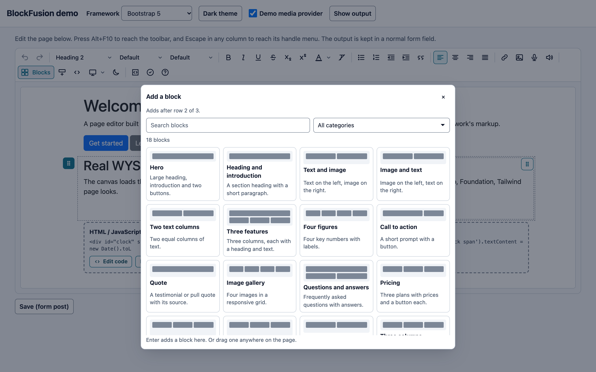

# Blocks



A block is one or more rows of columns, described as data rather than markup, so it is written once and rendered for whichever framework is active when it is inserted:

```json
{
	"id": "text-image",
	"name": "Text and image",
	"category": "Text",
	"description": "Text on the left, image on the right.",
	"thumbnail": "/img/text-image.png",
	"rows": [
		{
			"className": "highlight",
			"cols": [
				{ "span": 6, "html": "<h2>Tell the story</h2><p>…</p>" },
				{ "span": 6, "html": "" }
			]
		},
		{ "raw": "<iframe src=\"…\" title=\"Map\"></iframe>" }
	]
}
```

- `span`: a number of columns from the md breakpoint up, so columns stack on phones. An object such as `{ "base": 12, "sm": 6, "md": 4 }` sets each breakpoint (`base`, `sm`, `md`, `lg`, `xl`, `xxl`).
- Spans count in a 12 column grid unless the block sets `"columns"` (e.g. `"columns": 24`). They are rescaled to the editor's grid on insert.
- A column with `"kind": "raw"` holds verbatim HTML/JavaScript. A row written as `{ "raw": "…" }` is a raw row.
- `className`, `id`, `style` and `tag` can go on a row or a column, and any other attributes go in `attrs`.
- Ids and kinds are optional. `category`, `description` and `thumbnail` are optional too; without a thumbnail, a schematic preview is drawn.
- `rows` may also be a string of HTML in any known framework. It is detected and converted on insert, which is handy for pasting existing markup, but the JSON form is the one to write by hand.

In the block menu, click a block (or press Enter on it) to add it after the current row, or drag it onto the page: a line shows where it will go, above or below the row under the pointer. Rows can be moved afterwards from their handle menu (or Alt+Up / Alt+Down).

There are three ways to supply blocks:

- the `blocks` option, as an array;
- the `blocksUrl` option, pointing at a JSON array;
- `editor.addBlocks([...])`, from code or a plugin.

The block list updates live, and fresh ids are assigned on insert. Use the neutral button and visibility classes so blocks look right in every framework.

The 14 built-in blocks are:

- hero
- heading and introduction
- text and image
- image and text
- two text columns
- three features
- four figures
- call to action
- quote
- image gallery
- questions and answers
- pricing
- team
- contact details
